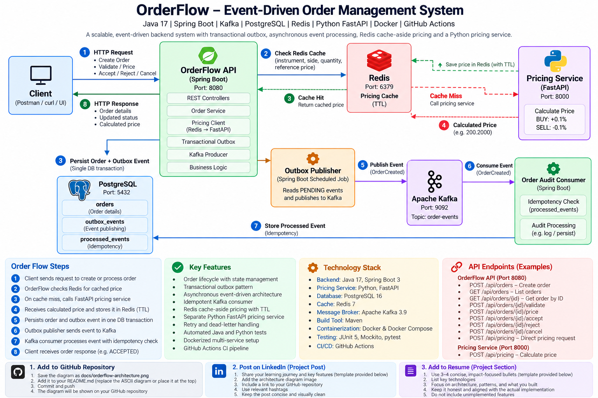

# OrderFlow

OrderFlow is an event-driven order management system built with Java, Spring Boot, Apache Kafka, PostgreSQL, Redis, and Python FastAPI.

The project demonstrates backend and distributed-systems patterns including transactional outbox messaging, asynchronous event processing, idempotent consumers, retry and dead-letter handling, cache-aside pricing, service-to-service communication, automated testing, CI, and containerized local deployment.

## System Architecture



## Architecture

```text
                                      ┌───────────────────────┐
                                      │        Client         │
                                      └───────────┬───────────┘
                                                  │ HTTP
                                                  ▼
                                      ┌───────────────────────┐
                                      │   Spring Boot API     │
                                      │       :8080           │
                                      └──────┬────┬─────┬─────┘
                                             │    │     │
                         ┌───────────────────┘    │     └──────────────────┐
                         │                        │                        │
                         ▼                        ▼                        ▼
                ┌─────────────────┐      ┌─────────────────┐      ┌─────────────────┐
                │   PostgreSQL    │      │      Redis      │      │      Kafka      │
                │     :5432       │      │      :6379      │      │  order-events   │
                │                 │      │                 │      │                 │
                │ orders          │      │ pricing cache   │      │ async events    │
                │ outbox_events   │      └────────┬────────┘      └────────┬────────┘
                │ processed_events│               │                        │
                └─────────────────┘               │ cache miss             │
                                                  ▼                        ▼
                                         ┌─────────────────┐      ┌─────────────────┐
                                         │ FastAPI Pricing │      │ Audit Consumer  │
                                         │     :8000       │      │ + Idempotency   │
                                         └─────────────────┘      └─────────────────┘
```

## Order Lifecycle

```text
RECEIVED
   │
   ▼
VALIDATED
   │
   ├──── pricing ────► calculatedPrice
   │
   ▼
ACCEPTED

RECEIVED / VALIDATED ───► REJECTED

Eligible orders ─────────► CANCELLED
```

Pricing is stored separately as `calculatedPrice`; pricing does not introduce a separate order status.

## Transactional Outbox

Creating an order requires both durable database state and an integration event.

Instead of writing directly to PostgreSQL and Kafka as two independent operations, OrderFlow stores the order and its outbox event within the same database transaction.

```text
POST /api/orders
        │
        ▼
@Transactional
        │
        ├── INSERT orders
        │
        └── INSERT outbox_events (PENDING)
                    │
                    ▼
             Outbox Publisher
                    │
                    ▼
                  Kafka
                    │
                    ▼
             Audit Consumer
                    │
                    ▼
             processed_events
```

The scheduled outbox publisher reads pending events, publishes them to Kafka, and marks successfully published records as `PUBLISHED`.

This provides an at-least-once delivery model. A failure after Kafka acknowledges a message but before the database marks the outbox event as published can cause redelivery, so consumers must tolerate duplicates.

## Idempotent Kafka Consumer

The audit consumer tracks processed event IDs in PostgreSQL.

```text
Kafka event
    │
    ▼
Check eventId
    │
    ├── already processed → ignore
    │
    └── new event
            │
            ▼
       process event
            │
            ▼
     processed_events
```

This prevents normal duplicate deliveries from repeatedly applying the same consumer processing.

## Retry and Dead-Letter Handling

Kafka consumer failures are handled using Spring Kafka error handling.

Failed messages are retried with a fixed backoff. After retries are exhausted, the message is published to:

```text
order-events.DLT
```

This prevents repeatedly failing messages from blocking normal event processing.

## Pricing Service

Pricing is implemented as a separate Python FastAPI service.

```text
Spring Boot
     │
     │ HTTP
     ▼
FastAPI Pricing Service
     │
     ▼
Calculated Price
```

The current pricing algorithm applies a deterministic adjustment to the reference price:

```text
BUY  → referencePrice × 1.001
SELL → referencePrice × 0.999
```

The service is intentionally simple; the purpose is to demonstrate service boundaries and Java-to-Python communication rather than model a production trading pricing engine.

## Redis Cache

Pricing uses the cache-aside pattern.

```text
Pricing Request
      │
      ▼
    Redis
      │
 ┌────┴─────┐
 │          │
HIT        MISS
 │          │
 ▼          ▼
Return    FastAPI
cached      │
price       ▼
          price
            │
            ▼
       store in Redis
       with TTL
            │
            ▼
          return
```

Example cache key:

```text
pricing:MSFT:BUY:100:300
```

Pricing entries expire using a configurable TTL.

## Technology Stack

### Backend

- Java 17
- Spring Boot
- Spring MVC
- Spring Data JPA
- Hibernate
- Spring Kafka
- Spring Data Redis
- Maven

### Data and Messaging

- PostgreSQL 16
- Apache Kafka 3.9.1
- Redis 7.4

### Pricing Service

- Python
- FastAPI
- Pydantic
- Uvicorn

### Testing

- JUnit 5
- Mockito
- Spring MockMvc
- pytest
- FastAPI TestClient

### DevOps

- Docker
- Docker Compose
- GitHub Actions

## Running OrderFlow

### Prerequisites

Install:

- Docker
- Docker Compose

Clone the repository and start the complete environment:

```bash
git clone <https://github.com/Abhishek-Codes-17/OrderFlow.git>
cd OrderFlow

docker compose up --build -d
```

Check the services:

```bash
docker compose ps
```

The environment contains:

| Service | Port |
|---|---:|
| Spring Boot Order API | 8080 |
| FastAPI Pricing Service | 8000 |
| PostgreSQL | 5432 |
| Kafka | 9092 |
| Redis | 6379 |

Check the pricing service:

```bash
curl http://localhost:8000/health
```

Expected:

```json
{
  "status": "UP",
  "service": "pricing-service"
}
```

## API Examples

### Create an Order

```bash
curl -X POST http://localhost:8080/api/orders \
  -H "Content-Type: application/json" \
  -d '{
    "instrumentId": "AAPL",
    "side": "BUY",
    "quantity": 100,
    "orderType": "LIMIT",
    "price": 200.00
  }'
```

Example response:

```json
{
  "id": "<generated-uuid>",
  "instrumentId": "AAPL",
  "side": "BUY",
  "quantity": 100,
  "orderType": "LIMIT",
  "price": 200.0000,
  "calculatedPrice": null,
  "status": "RECEIVED",
  "createdAt": "<timestamp>"
}
```

### List Orders

```bash
curl http://localhost:8080/api/orders
```

### Get Order

```bash
curl http://localhost:8080/api/orders/<ORDER_ID>
```

### Validate Order

```bash
curl -X POST \
  http://localhost:8080/api/orders/<ORDER_ID>/validate
```

### Price Order

```bash
curl -X POST \
  http://localhost:8080/api/orders/<ORDER_ID>/price
```

Example calculated price for a BUY order with reference price `200`:

```text
200 × 1.001 = 200.2000
```

### Accept Order

```bash
curl -X POST \
  http://localhost:8080/api/orders/<ORDER_ID>/accept
```

### Reject Order

```bash
curl -X POST \
  http://localhost:8080/api/orders/<ORDER_ID>/reject
```

### Cancel Order

```bash
curl -X POST \
  http://localhost:8080/api/orders/<ORDER_ID>/cancel
```

## Direct Pricing API

```bash
curl -X POST http://localhost:8080/api/pricing \
  -H "Content-Type: application/json" \
  -d '{
    "instrument_id": "MSFT",
    "side": "BUY",
    "quantity": 100,
    "reference_price": 300
  }'
```

Example response:

```json
{
  "instrument_id": "MSFT",
  "side": "BUY",
  "quantity": 100,
  "reference_price": 300,
  "calculated_price": 300.3000
}
```

Repeated identical pricing requests can be served from Redis until the cache entry expires.

## Running Tests

### Java

```bash
./mvnw test
```

The targeted Java test suite covers domain behavior, service logic, and controller/API behavior.

### Python

```bash
cd pricing-service
python -m pytest -v
```

The Python tests cover pricing calculations, health checks, and request validation.

## Continuous Integration

GitHub Actions runs automated Java and Python tests for pushes and pull requests to `main`.

The CI pipeline uses:

- JDK 17
- Maven
- Python
- pytest

This ensures the targeted test suites are reproducible independently of locally running PostgreSQL, Kafka, or Redis infrastructure.

## Configuration

OrderFlow supports environment-based configuration while retaining local-development defaults.

Examples:

```text
DB_URL
DB_USERNAME
DB_PASSWORD
KAFKA_BOOTSTRAP_SERVERS
REDIS_HOST
REDIS_PORT
PRICING_SERVICE_URL
```

Docker Compose supplies container-network addresses such as:

```text
postgres:5432
kafka:29092
redis:6379
pricing-service:8000
```

while local development can continue using `localhost`.

## Design Decisions

**Transactional outbox instead of direct dual writes**

An order and its integration event are committed atomically to PostgreSQL. Kafka publication happens asynchronously from the outbox.

**At-least-once delivery instead of claiming exactly-once processing**

Outbox publication can produce duplicate delivery around failure boundaries, so consumers are designed to tolerate repeated events.

**Redis cache-aside instead of making pricing dependent on the cache**

Redis accelerates repeated pricing requests, while FastAPI remains the source used to calculate prices on cache misses.

**Separate pricing service**

Pricing provides a small polyglot service boundary demonstrating HTTP communication between Java and Python components.

**Database-backed processed-event tracking**

Consumed Kafka event IDs are persisted so duplicate deliveries can be detected across application restarts.

## Current Scope

OrderFlow is a portfolio system focused on backend architecture and distributed-systems patterns.

Current implementation includes:

- Order creation and lifecycle management
- PostgreSQL persistence
- Transactional outbox
- Kafka event publication and consumption
- Consumer idempotency tracking
- Retry and dead-letter handling
- FastAPI pricing service
- Redis pricing cache
- Automated Java and Python tests
- GitHub Actions CI
- Docker Compose deployment

Potential future improvements include:

- Flyway database migrations
- Schema Registry / Avro or Protobuf
- Stronger atomic consumer idempotency
- Resilience4j timeouts, retries, and circuit breakers
- Micrometer, Prometheus, and Grafana
- Distributed tracing and correlation IDs
- Load testing and measured performance benchmarks
- Authentication and authorization
- Kubernetes/cloud deployment

## Disclaimer

OrderFlow is an educational and portfolio project. The pricing logic is intentionally simplified and should not be interpreted as a production trading or investment pricing model.